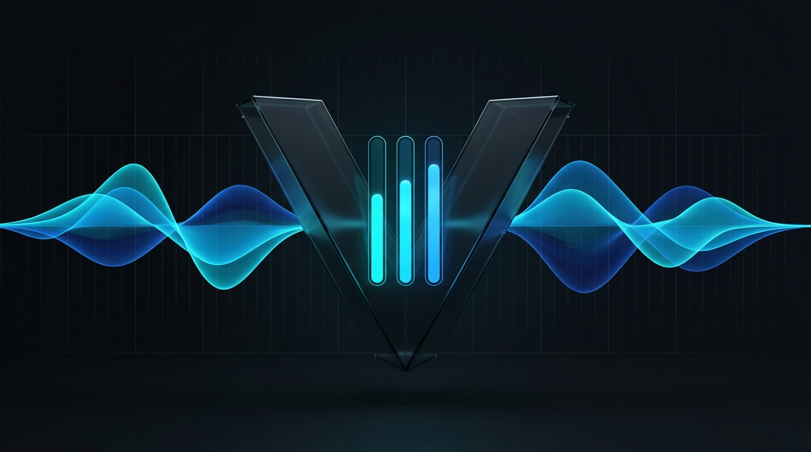
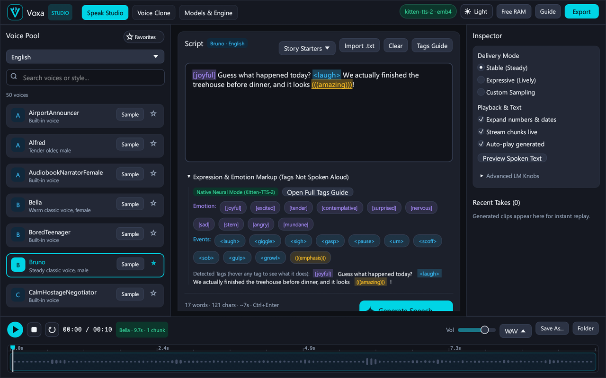
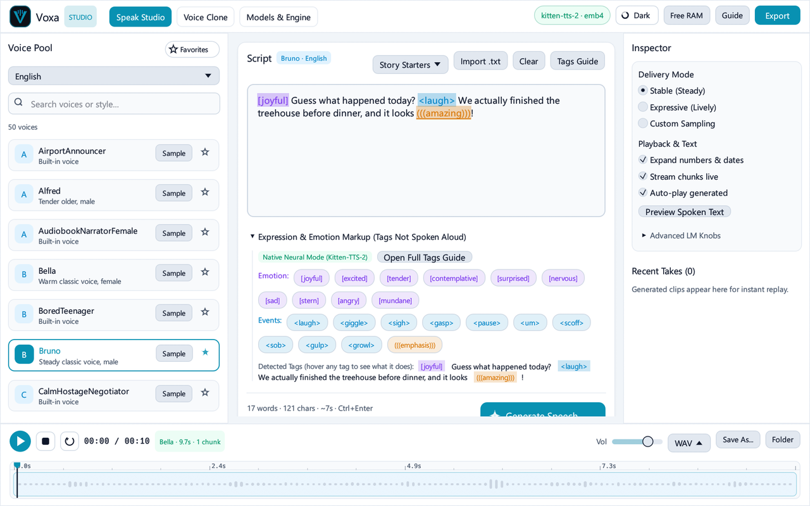
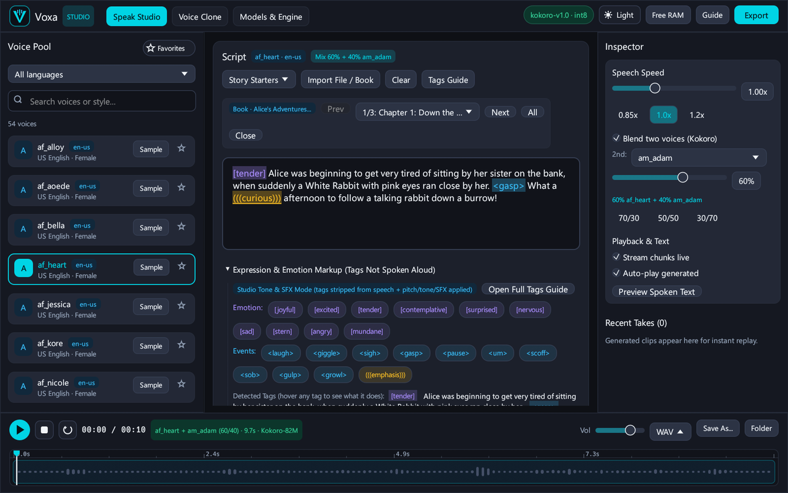
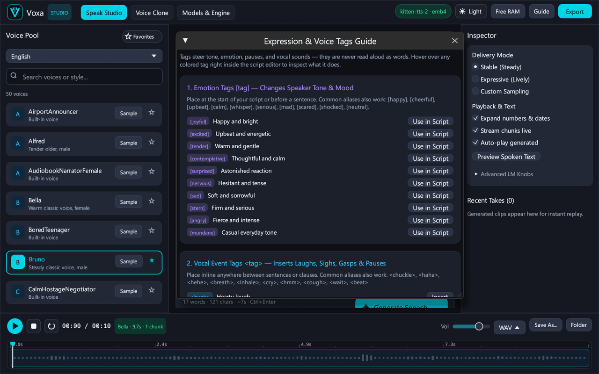
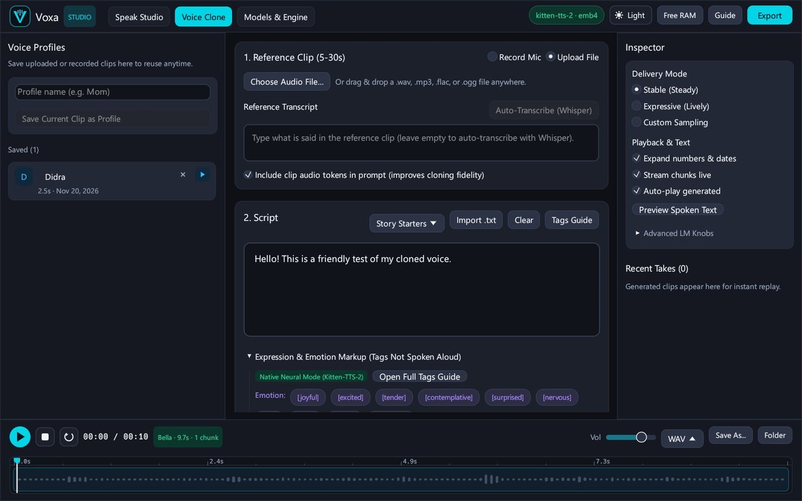
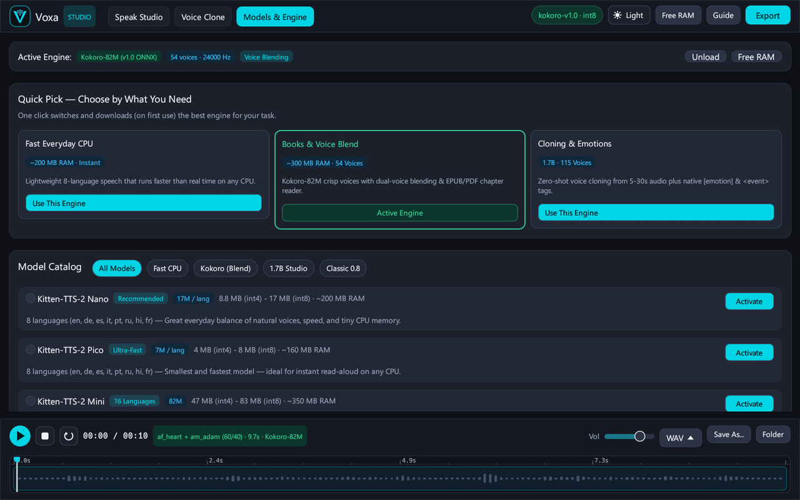
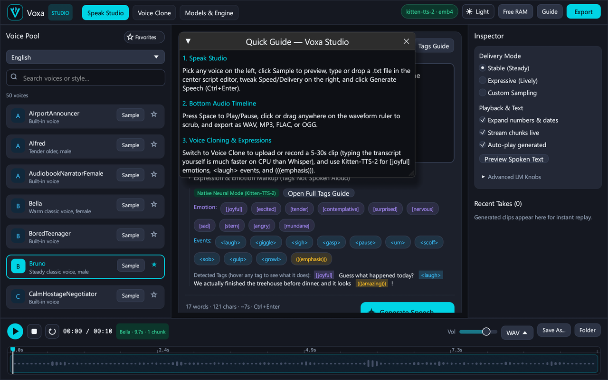
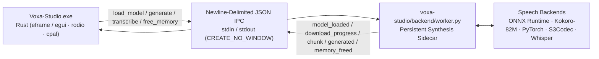

<div align="center">

<picture>
  <source media="(prefers-color-scheme: dark)" srcset="assets/logo-wordmark-dark.svg">
  <source media="(prefers-color-scheme: light)" srcset="assets/logo-wordmark-light.svg">
  
</picture>

<h3>Local-First Neural Voice, Expressive Narration &amp; Zero-Shot Cloning Studio</h3>

<p>
  
  
  
  
  
</p>



<p>
  <a href="#highlights">Highlights</a> •
  <a href="#interface-walkthrough--page-by-page-guide">Screenshots &amp; Guide</a> •
  <a href="#quick-start">Install &amp; Quick Start</a> •
  <a href="#supported-models">Supported Models</a> •
  <a href="#expression-markup">Expression Markup</a> •
  <a href="#architecture">Architecture</a> •
  <a href="#memory-engineering">Memory Engineering</a> •
  <a href="#build-from-source">Build from Source</a> •
  <a href="#license">License</a>
</p>

</div>

---

**Voxa Studio** is a native Rust desktop workspace (`eframe` / `egui`) paired with a silent Python neural synthesis sidecar. It brings fast offline text-to-speech, Kokoro-82M 54-voice dual-voice blending, EPUB & PDF book/chapter reading, inline expressive voice direction (`[emotion]`, `<event>`, `(((emphasis)))`), zero-shot voice cloning, live download telemetry, and a scrubbable multi-format audio timeline to Windows without requiring terminal commands.

> [!NOTE]
> Powered by [KittenML/KittenTTS](https://github.com/KittenML/KittenTTS) (`Apache-2.0`) and [nazdridoy/kokoro-tts](https://github.com/nazdridoy/kokoro-tts) / [thewh1teagle/kokoro-onnx](https://github.com/thewh1teagle/kokoro-onnx) (`MIT`). Models are fetched automatically on first selection and cached locally in `~/.cache/huggingface` and `~/.cache/voxa-studio` for private offline use.

---

## Highlights

- **One-Click Windows Setup (`Voxa-Studio-Setup.exe`)** — Pure-Rust Windows installer provisions `.venv`, installs neural backends without requiring Git, and creates Desktop & Start Menu shortcuts.
- **Native Dark & Light Studio UI** — High-contrast obsidian and electric-cyan dark studio palette alongside a crisp slate light mode with persisted user settings (`studio_data/config.json`).
- **Speak Studio & Book Reader** — Searchable multi-language voice browser with Favorites (`★`), voice personality notes, one-click **Sample** previews, **Story Starters**, and **Import File / Book** (`.txt`, `.md`, `.epub`, `.pdf` drag-and-drop with chapter navigation).
- **Kokoro-82M Studio Voices & Dual-Voice Blending** — 54 crisp 24 kHz voices across 9 languages (`en-us`, `en-gb`, `ja`, `cmn`, `es`, `fr-fr`, `it`, `hi`, `pt-br`) with real-time dual-voice style blending (`50/50`, `60/40`, `70/30` presets or custom slider).
- **Color-Coded Expression Markup & Hover Inspector** — Highlights `[emotion]`, `<event>`, and `(((emphasis)))` tags inline inside the script editor, shows contextual tooltips on hover, and includes an interactive **Tags Guide**. Tags steer vocal delivery and are never read aloud as words.
- **Zero-Shot Voice Cloning** — Clone any voice from a 5–30s audio upload or built-in microphone recording with live peak metering, saved **Voice Profiles**, and optional automatic Whisper transcription.
- **Interactive Timeline & Audio Export** — Scrubbable waveform ruler, real-time streamed chunk playback, playback volume control, and lossless/compressed export (`WAV`, `MP3`, `FLAC`, `OGG`).
- **Quick Pick Engine Switcher & Live Download Control** — Choose engines by use case (**Fastest CPU**, **Balanced Multi-Language**, **Book & Voice Blending**, or **Voice Cloning**), filter by category, monitor per-file download progress (`MB/s`, ETA), or cancel mid-download while restoring the previous working engine.
- **Engine Activity Log & RAM Guardrails** — Copyable activity log, Hugging Face cache/symlink warning suppression, meta-device streaming model loader, and one-click **Free RAM** cleanup.

---

## Interface Walkthrough & Page-by-Page Guide

### 1. Speak Studio — Main Narration Workspace (Dark & Light Modes)

<p align="center">
  
</p>

The workspace is structured into five non-overlapping studio zones:

1. **Top Studio Header Bar** — Switch between **Speak Studio**, **Voice Clone**, and **Models & Engine** on the left; on the right, inspect the active engine pill (`kitten-tts-2 · emb4`), toggle **Light / Dark** mode, release transient host memory with **Free RAM**, open **Guide**, or **Export** rendered audio.
2. **Left Voice Pool** — Filter voices by language, search by voice name or vocal character, click the star icon (`★`) to pin **Favorites**, click **Sample** for a quick voice preview, or click a voice card to select it.
3. **Center Script Canvas** — Write narration directly, load curated **Story Starters**, or click **Import File / Book** (or drag-and-drop `.txt`, `.md`, `.epub`, or `.pdf` files with chapter navigation). Expression tags (`[joyful]`, `<laugh>`, `(((amazing)))`) render in distinct colors right inside the editor with instant hover tooltips. Press **`Ctrl+Enter`** (or click **Generate Speech**) to synthesize.
4. **Right Inspector & Recent Takes** — Choose Delivery Mode (**Stable**, **Expressive**, or **Custom Sampling**), blend two Kokoro voices smoothly, toggle **Expand numbers & dates**, **Stream chunks live**, and **Auto-play generated**, preview spoken normalization/phonemes, or replay clips from **Recent Takes**.
5. **Bottom Audio Timeline Dock** — Press **`Space`** or click Play/Pause/Stop/Replay, click or drag anywhere on the time-ruled waveform clip to scrub, adjust playback **Vol**, and save as **`WAV`**, **`MP3`**, **`FLAC`**, or **`OGG`**.

<details>
<summary><strong>Preview Light Studio Mode</strong> — crisp daylight contrast with persisted theme state</summary>
<br>
<p align="center">
  
</p>
</details>

---

### 2. Kokoro-82M, Voice Blending & EPUB/PDF Book Reader

<p align="center">
  
</p>

Activate **Kokoro-82M (v1.0 ONNX)** to unlock 54 crisp studio voices across 9 languages alongside native voice blending and multi-chapter document reading:

1. **54-Voice / 9-Language Catalog** — Browse dedicated US & UK English, Japanese, Mandarin Chinese, Spanish, French, Italian, Hindi, and Brazilian Portuguese voices with searchable personality descriptions.
2. **Dual-Voice Blending (Right Inspector)** — Enable **Blend two voices** in the Right Inspector, pick a second partner voice, and shape the mix with one-click ratio presets (**50/50**, **60/40**, **70/30**) or the fine weight slider to interpolate speaker style vectors cleanly.
3. **EPUB & PDF Book / Chapter Reader** — Click **Import File / Book** (or drop `.epub` / `.pdf` / `.txt` / `.md` onto the workspace) to extract book chapters cleanly and step through them with **Prev** / **Next Chapter** controls right above the script editor.

---

### 3. Expression & Voice Tags Guide

<p align="center">
  
</p>

Click **Tags Guide** above the Script editor (or **Open Full Tags Guide** below it) to browse every supported tag without leaving your script:

1. **Emotion Tone Tags (`[tag]`)** — Place at the start of a script or sentence (`[joyful]`, `[tender]`, `[contemplative]`, `[excited]`, `[stern]`, `[angry]`, etc., plus natural aliases like `[happy]`, `[whisper]`, `[calm]`) to steer delivery tone.
2. **Vocal Event Cues (`<tag>`)** — Insert inline (`<laugh>`, `<giggle>`, `<sigh>`, `<gasp>`, `<pause>`, `<um>`, `<scoff>`, `<sob>`, `<gulp>`, `<growl>`) to synthesize realistic breaths, laughs, and pauses without speaking the word aloud.
3. **Emphasis (`(((phrase)))`)** — Wrap 1–4 words in triple parentheses to add vocal stress and pitch inflection.
4. **One-Click Insertion & Inline Hover Inspection** — Click **Use in Script** on any row in the guide to insert/apply it, or hover directly over any colored tag inside the editor to inspect its exact behavior.

---

### 4. Voice Clone Studio

<p align="center">
  
</p>

Switch to the **Voice Clone** tab to clone any speaking style in seconds:

1. **Supply a 5–30s Reference Clip** — Drag-and-drop or browse a `.wav`, `.mp3`, `.flac`, or `.ogg` file under **Upload File**, or switch to **Record Mic** to capture directly with the live peak level meter.
2. **Enter or Auto-Transcribe Reference Text** — Typing the exact words spoken in the short reference clip gives fast, accurate alignment on CPU; leaving it blank runs Whisper auto-transcription (and automatically unloads Whisper right afterward to save RAM). Keep **Include clip audio tokens in prompt** checked for higher timbre fidelity.
3. **Save Reusable Voice Profiles** — Name your clip in the left **Voice Profiles** sidebar and click **Save Current Clip as Profile** to recall that cloned speaker anytime with one click.
4. **Write Your Script & Generate** — Enter your script (with optional `[emotion]` / `<event>` / `(((emphasis)))` markup) and click **Generate Speech** (`Ctrl+Enter`). *Note: Voice Cloning runs on **Kitten-TTS-2 (1.7B Studio)**; if a Tiny ONNX model is currently active, click the prompt card button to load 1.7B automatically.*

---

### 5. Models & Engine Manager

<p align="center">
  
</p>

Open **Models & Engine** (or click the green active-engine pill in the top header) to pick an engine by goal, switch precision cleanly, and monitor downloads:

1. **Quick Pick — Choose by What You Need** — Three plain-English preset cards (**Fast Everyday CPU**, **Books & Voice Blend**, and **Cloning & Emotions**) launch the right engine in one click.
2. **Active Engine Capability Strip, `Free RAM` & `Unload`** — Shows the active repo ID, sample rate (`24000 Hz`), precision, voice count, supported capabilities (`Voice Blending`, `Zero-Shot Cloning`, `Neural Expression`, etc.), **Free RAM**, and **Unload Model**.
3. **Category Filter Pills & Inline Quality Selector** — Filter the catalog (**All**, **Fast CPU**, **Kokoro-82M**, **1.7B Studio**, **Classic 0.8**) and pick plain-English size/quality variants (`Balanced 88 MB` / `FP16` / `FP32` for Kokoro, `Compact int8` / `Tiny int4` for Nano/Pico/Mini, or `Compact 4-bit emb4` for 1.7B) directly inside the active card, with live transfer speed (`MB/s`), ETA, and **Cancel Download** safety.
4. **Collapsible Advanced Settings & Copyable Activity Log** — Tuck CPU/CUDA device, CPU thread count, custom repo IDs, and cache/token overrides under **Advanced Hardware, Custom Models & Cache**, with live diagnostics in **Engine Activity Log**.

---

### 6. In-App Quick Guide

<p align="center">
  
</p>

Click **Guide** in the top header anytime to summon the compact **Quick Guide — Voxa Studio** overlay with essential shortcuts (`Ctrl+Enter`, `Space`) and CPU cloning tips.

---

## Quick Start

### Option A — Windows Setup Wizard (Recommended)

<div align="center">

[-00D4E5?style=for-the-badge&logo=windows&logoColor=071318)](https://github.com/didrarayyan/Voxa-Studio/releases/latest/download/Voxa-Studio-Setup.exe)
&nbsp;
[](https://github.com/didrarayyan/Voxa-Studio/releases/latest)

</div>

1. Download and run **`Voxa-Studio-Setup.exe`** from the [**Latest GitHub Release**](https://github.com/didrarayyan/Voxa-Studio/releases/latest).
2. Choose an install folder (defaults to `%LOCALAPPDATA%\VoxaStudio` — **no Administrator rights or Git required**).
3. Click **Install Voxa Studio**. The installer automatically:
   - Extracts `Voxa-Studio.exe`, backend worker, icon, and license files
   - Detects Python `3.10–3.12` (or silently installs Python 3.11 via `winget` if missing)
   - Creates an isolated `.venv` and installs `PyTorch`, `ONNX Runtime`, `KittenTTS`, `kokoro-onnx`, `ebooklib`, `beautifulsoup4`, `pymupdf`, and `en_core_web_sm`
   - Adds Desktop / Start Menu shortcuts and registers a clean uninstaller in Windows **Installed Apps**
4. Launch **Voxa Studio** — your selected voice model downloads automatically on first run and caches locally for offline use.

### CPU Performance Tips

| Use Case | Recommended Model | Why |
| :--- | :--- | :--- |
| Fast everyday narration | `Kitten-TTS-2 Nano` (`int8`) | Synthesizes faster than real time on CPU (`~850 MB–1.38 GB` total process commit). |
| Books, 54 voices & blending | `Kokoro-82M (v1.0 ONNX)` (`int8`) | Ultra-low `~300 MB` RAM, crisp 24 kHz audio across 9 languages, dual-voice blending & EPUB/PDF chapters. |
| Lowest disk & RAM | `Kitten-TTS-2 Pico` (`int4`) | Tiny 4 MB weights, ideal for quick read-aloud. |
| Rich 16-language speech | `Kitten-TTS-2 Mini` (`int8`) | Covers Japanese, Korean, Swedish, Turkish, European & South Asian languages. |
| Voice cloning & neural tags | `Kitten-TTS-2 (1.7B Studio)` | Keep `emb4` + `student_w4` + `CPU` unless your GPU has >= 6 GB VRAM; typing the short reference transcript skips loading Whisper. |

---

## Supported Models

| Model | Repo ID | Params | Disk Weights | Typical RAM Footprint | Capabilities |
| :--- | :--- | :---: | :--- | :--- | :--- |
| **Kokoro-82M (v1.0 ONNX)** | `kokoro-tts/kokoro-v1.0` | `82M` | `88 MB` (`int8`) – `310 MB` (`fp32`) + `26.9 MB` voices | `~300 MB` RAM | 9 languages (`en-us, en-gb, ja, cmn, es, fr-fr, it, hi, pt-br`) · 54 voices, Dual-Voice Blending, EPUB/PDF chapter reader |
| **Kitten-TTS-2 Nano** | `KittenML/kitten-tts-2-nano` | `17M / lang` | `8.8 MB` (`int4`) – `17 MB` (`int8`) | `~200 MB` model (`~0.85–1.38 GB` process commit) | 8 languages (`en, de, es, it, pt, ru, hi, fr`), speed control, DSP expression & event cues |
| **Kitten-TTS-2 Pico** | `KittenML/kitten-tts-2-pico` | `7M / lang` | `4 MB` (`int4`) – `8 MB` (`int8`) | `~160 MB` model | Ultra-fast 8-language CPU synthesis |
| **Kitten-TTS-2 Mini** | `KittenML/kitten-tts-2-mini` | `82M` | `47 MB` (`int4`) – `83 MB` (`int8`) | `~350 MB` model | 16 languages incl. `ja, ko, sv, tr` |
| **Kitten-TTS-2 (1.7B Studio)** | `KittenML/kitten-tts-2` | `1.7B` | `492 MB` (`emb4`) – `954 MB` (`packed`) + decoder | `~6.8 GB` process commit on CPU (1.7B `bf16` + `S3Codec`) | 20+ languages, 115 voices, zero-shot voice cloning, native neural `[emotion]` / `<event>` / `(((emphasis)))` |
| **Classic ONNX 0.8** | `KittenML/kitten-tts-*-0.8*` | `15M – 80M` | `25 MB – 80 MB` | Lightweight ONNX | English classic 8-voice catalog |

---

## Expression Markup

Voxa Studio parses expression markup in real time and dispatches native neural conditioning on **Kitten-TTS-2 (1.7B)** or prosody/pitch/SFX shaping on lightweight ONNX models:

| Syntax | Purpose | Supported Tags & Common Aliases |
| :--- | :--- | :--- |
| **`[emotion]`** | Steers speaker tone and emotional cadence | `joyful` (`happy`, `cheerful`), `excited` (`upbeat`), `tender` (`whisper`, `gentle`, `soft`), `contemplative` (`calm`, `thoughtful`), `surprised` (`shocked`), `nervous` (`fearful`, `anxious`), `sad`, `stern` (`serious`, `firm`), `angry` (`mad`), `mundane` (`neutral`) |
| **`<event>`** | Inserts non-verbal vocal cues without reading the word | `laugh` (`chuckle`, `haha`), `giggle` (`hehe`), `sigh` (`breath`, `exhale`), `gasp` (`inhale`), `pause` (`wait`, `beat`), `um` (`hmm`, `uh`), `scoff` (`cough`), `sob` (`cry`), `gulp` (`swallow`), `growl` |
| **`(((phrase)))`** | Applies vocal stress & pitch accent to 1–4 words | Wrap any target word/phrase inside triple parentheses, e.g. `(((amazing)))` |

```text
[joyful] Guess what happened today? <laugh> We finished before dinner, and it sounds (((incredible)))!
```

---

## Architecture

Voxa Studio separates responsive 60 fps UI rendering, real-time audio playback, and microphone capture in Rust from ML runtime isolation in Python:



- **Zero Terminal Flash**: Spawned with `CREATE_NO_WINDOW` (`0x08000000`) on Windows; third-party prints are redirected to `stderr` so JSON stdout frames stay strictly valid.
- **Clean Process Lifecycle**: Stopping or cancelling a download terminates and respawns the sidecar cleanly while preserving/restoring the active engine configuration.

---

## Memory Engineering

Large 1.7B models can easily spike host RAM past `10–11 GB` under naïve CPU loading and voice cloning. Voxa Studio addresses this inside [`voxa-studio/backend/worker.py`](voxa-studio/backend/worker.py) without patching the upstream `kittenml` package:

1. **Meta-Device Streaming Loader**: Constructs the transformer skeleton on `torch.device("meta")`, materializes rotary embeddings on the target device, and streams unpacked `emb4`/`packed` weights tensor-by-tensor — cutting peak load commit from `~11.0 GB` down to `~8.3 GB` (and eliminating duplicate 1.7B parameter allocation).
2. **Auto-Unloading Voice Clone Helpers**: Automatically uses `openai/whisper-base` instead of 1.55B `whisper-large-v3` on CPU auto-transcription, and unloads both Whisper and `SpeakerEncoder` immediately after encoding.
3. **Bounded Caches & Working-Set Trim**: Caps speaker/vocoder reference caches, bounds CPU synthesis chunks (`<= 240` chars), compacts Windows CRT heaps (`_heapmin()`), and exposes a **Free RAM** control (`SetProcessWorkingSetSize(-1, -1)` and full model unload support).

---

## Project Layout

```text
Voxa-Studio/
├── .github/workflows/
│   └── release.yml            # Builds & publishes Voxa-Studio-Setup.exe on v* tags
├── assets/
│   ├── screenshots/           # Page-by-page UI walkthrough PNG screenshots
│   └── *.svg, *.png           # Master brand vector logos, raster icons & hero banner
├── docs/
│   └── BRAND.md               # Brand identity, color palette & asset guidelines
├── voxa-studio/               # Rust desktop application, installer & Python sidecar
│   ├── build.rs               # Compiles Windows ICO & VERSIONINFO resources
│   ├── Cargo.toml             # Binary crate config (voxa-studio + optional voxa-setup)
│   ├── assets/                # Embedded icons (.png, .ico) & Win32 resources (app.rc, setup.rc)
│   ├── src/
│   │   ├── main.rs            # Voxa Studio GUI entry point
│   │   ├── setup.rs           # Standalone Voxa-Studio-Setup.exe Windows installer wizard
│   │   └── ...                # app.rs, theme.rs, protocol.rs, worker.rs, audio.rs, recorder.rs, state.rs
│   └── backend/
│       └── worker.py          # JSON-lines sidecar, DSP engine & memory manager
├── .gitignore
├── requirements.txt           # Installs upstream kittenml synthesis engine via pip
├── LICENSE
└── README.md
```

---

## Build from Source

### Prerequisites

- **Rust** toolchain (`1.80+`, tested with `rustc 1.100.0 x86_64-pc-windows-gnu` and MSVC in GitHub Actions)
- **Python 3.10–3.12** (for the synthesis sidecar `.venv\`)

### Clone, Test & Build App + Setup Installer

```powershell
git clone https://github.com/didrarayyan/Voxa-Studio.git
cd Voxa-Studio

# Set up Python synthesis sidecar
python -m venv .venv
.\.venv\Scripts\pip.exe install -r requirements.txt
.\.venv\Scripts\python.exe -m spacy download en_core_web_sm

# Build Voxa-Studio.exe & optional Voxa-Studio-Setup.exe
cd voxa-studio
cargo test
cargo build --release --bin voxa-studio
Copy-Item .\target\release\voxa-studio.exe ..\Voxa-Studio.exe -Force

# Optional: bundle everything into a standalone Windows Setup wizard
cargo test --bin voxa-setup --features installer
cargo build --release --bin voxa-setup --features installer
Copy-Item .\target\release\voxa-setup.exe ..\Voxa-Studio-Setup.exe -Force
```

<details>
<summary><strong>Keyboard Shortcuts &amp; Troubleshooting</strong></summary>

| Shortcut | Action |
| :--- | :--- |
| `Ctrl + Enter` | Generate speech for the active script |
| `Space` | Play / Pause timeline playback |

- **Download stalled or switched engine by mistake?** Click **Cancel Download** in the status card to abort cleanly and restore the previous active engine.
- **High RAM after heavy Voice Cloning?** Click **Free RAM** in the top studio bar to release transient Whisper/speaker encoders and trim inactive working-set pages.
- **Verify Python speech backend:** `.\.venv\Scripts\python.exe -c "import kittenml; print('kittenml ready')"`

</details>

---

## Documentation & Brand

- Brand specifications, color palette, typography, and SVG/PNG logo rules: [`docs/BRAND.md`](docs/BRAND.md)

## Acknowledgements & License

- Built on top of [**KittenML/KittenTTS**](https://github.com/KittenML/KittenTTS) and upstream speech/vocoder components licensed under **Apache-2.0**.
- Integrates **Kokoro-82M** ONNX voice & blending support inspired by [**nazdridoy/kokoro-tts**](https://github.com/nazdridoy/kokoro-tts) (`MIT`) and powered by [**thewh1teagle/kokoro-onnx**](https://github.com/thewh1teagle/kokoro-onnx) (`MIT`).
- Released under the **Apache License 2.0** — see [`LICENSE`](LICENSE) for full terms.
