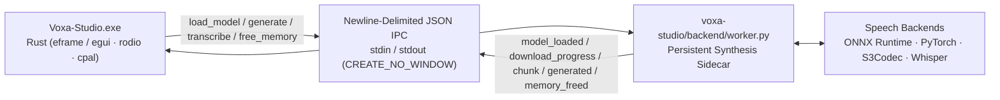

<div align="center">

<picture>
  <source media="(prefers-color-scheme: dark)" srcset="assets/logo-wordmark-dark.svg">
  <source media="(prefers-color-scheme: light)" srcset="assets/logo-wordmark-light.svg">
  
</picture>

<h3>Local-First Neural Voice, Expressive Narration &amp; Zero-Shot Cloning Studio</h3>

<p>
  
  
  
  
  
</p>


<p>
  <a href="#highlights">Highlights</a> •
  <a href="#quick-start">Quick Start</a> •
  <a href="#supported-models">Supported Models</a> •
  <a href="#expression-markup">Expression Markup</a> •
  <a href="#architecture">Architecture</a> •
  <a href="#memory-engineering">Memory Engineering</a> •
  <a href="#build-from-source">Build from Source</a> •
  <a href="#license">License</a>
</p>

</div>

---

**Voxa Studio** is a native Rust desktop workspace (`eframe` / `egui`) paired with a silent Python neural synthesis sidecar. It brings fast offline text-to-speech, inline expressive voice direction (`[emotion]`, `<event>`, `(((emphasis)))`), zero-shot voice cloning, live download telemetry, and a scrubbable multi-format audio timeline to Windows without requiring terminal commands.

> [!NOTE]
> Powered by the open-source [KittenML/KittenTTS](https://github.com/KittenML/KittenTTS) speech models (`Apache-2.0`). Models are automatically fetched from Hugging Face on first selection and cached locally in `~/.cache/huggingface` for private offline use.

---

## Highlights

- **Native Dark & Light Studio UI** — High-contrast obsidian and electric-cyan dark studio palette alongside a crisp slate light mode with persisted user settings (`studio_data/config.json`).
- **Speak Studio** — Searchable multi-language voice browser with Favorites (`★`), voice personality notes, one-click **Sample** previews, **Story Starters**, and `.txt` / `.md` file drag-and-drop.
- **Color-Coded Expression Markup & Hover Inspector** — Highlights `[emotion]`, `<event>`, and `(((emphasis)))` tags inline inside the script editor, shows contextual tooltips on hover, and includes an interactive **Tags Guide**. Tags steer vocal delivery and are never read aloud as words.
- **Zero-Shot Voice Cloning** — Clone any voice from a 5–30s audio upload or built-in microphone recording with live peak metering, saved **Voice Profiles**, and optional automatic Whisper transcription.
- **Interactive Timeline & Audio Export** — Scrubbable waveform ruler, real-time streamed chunk playback, playback volume control, and lossless/compressed export (`WAV`, `MP3`, `FLAC`, `OGG`).
- **Engine Switcher & Live Download Control** — Switch immediately between ultra-fast ONNX CPU models and the 1.7B neural speech LM, monitor per-file download progress (`MB/s`, ETA), or cancel mid-download while restoring the previous working engine.
- **Engine Activity Log & RAM Guardrails** — Copyable activity log, Hugging Face cache/symlink warning suppression, meta-device streaming model loader, and one-click **Free RAM** cleanup.

---

## Quick Start

### Launch Desktop App

1. Double-click **`Voxa-Studio.exe`** at the repository root — zero console window opens.
2. On first run, the active engine downloads from Hugging Face and caches locally for offline reuse.
3. Choose a voice in **Speak Studio**, type or drop your script, and press **`Ctrl+Enter`** (or click **Generate Speech**).

### CPU Performance Tips

| Use Case | Recommended Model | Why |
| :--- | :--- | :--- |
| Fast everyday narration | `Kitten-TTS-2 Nano` (`int8`) | Synthesizes faster than real time on CPU (~850 MB–1.38 GB total process commit). |
| Lowest disk & RAM | `Kitten-TTS-2 Pico` (`int4`) | Tiny 4 MB weights, ideal for quick read-aloud. |
| Rich 16-language speech | `Kitten-TTS-2 Mini` (`int8`) | Covers Japanese, Korean, Swedish, Turkish, European & South Asian languages. |
| Voice cloning & neural tags | `Kitten-TTS-2 (1.7B Studio)` | Keep `emb4` + `student_w4` + `CPU` unless your GPU has >= 6 GB VRAM; typing the short reference transcript skips loading Whisper. |

---

## Supported Models

| Model | Repo ID | Params | Disk Weights | Typical RAM Footprint | Capabilities |
| :--- | :--- | :---: | :--- | :--- | :--- |
| **Kitten-TTS-2 Nano** | `KittenML/kitten-tts-2-nano` | `17M / lang` | `8.8 MB` (`int4`) – `17 MB` (`int8`) | `~200 MB` model (`~0.85–1.38 GB` process commit) | 8 languages (`en, de, es, it, pt, ru, hi, fr`), speed control, DSP expression & event cues |
| **Kitten-TTS-2 Pico** | `KittenML/kitten-tts-2-pico` | `7M / lang` | `4 MB` (`int4`) – `8 MB` (`int8`) | `~160 MB` model | Ultra-fast 8-language CPU synthesis |
| **Kitten-TTS-2 Mini** | `KittenML/kitten-tts-2-mini` | `82M` | `47 MB` (`int4`) – `83 MB` (`int8`) | `~350 MB` model | 16 languages incl. `ja, ko, sv, tr` |
| **Kitten-TTS-2 (1.7B Studio)** | `KittenML/kitten-tts-2` | `1.7B` | `492 MB` (`emb4`) – `954 MB` (`packed`) + decoder | `~6.8 GB` process commit on CPU (1.7B `bf16` + `S3Codec`) | 20+ languages, 115 voices, zero-shot voice cloning, native neural `[emotion]` / `<event>` / `(((emphasis)))` |
| **Classic ONNX 0.8** | `KittenML/kitten-tts-*-0.8*` | `15M – 80M` | `25 MB – 80 MB` | Lightweight ONNX | English classic 8-voice catalog |

---

## Expression Markup

Voxa Studio parses expression markup in real time and dispatches native neural conditioning on **Kitten-TTS-2 (1.7B)** or prosody/pitch/SFX shaping on lightweight ONNX models:

| Syntax | Purpose | Supported Tags & Common Aliases |
| :--- | :--- | :--- |
| **`[emotion]`** | Steers speaker tone and emotional cadence | `joyful` (`happy`, `cheerful`), `excited` (`upbeat`), `tender` (`whisper`, `gentle`, `soft`), `contemplative` (`calm`, `thoughtful`), `surprised` (`shocked`), `nervous` (`fearful`, `anxious`), `sad`, `stern` (`serious`, `firm`), `angry` (`mad`), `mundane` (`neutral`) |
| **`<event>`** | Inserts non-verbal vocal cues without reading the word | `laugh` (`chuckle`, `haha`), `giggle` (`hehe`), `sigh` (`breath`, `exhale`), `gasp` (`inhale`), `pause` (`wait`, `beat`), `um` (`hmm`, `uh`), `scoff` (`cough`), `sob` (`cry`), `gulp` (`swallow`), `growl` |
| **`(((phrase)))`** | Applies vocal stress & pitch accent to 1–4 words | Wrap any target word/phrase inside triple parentheses, e.g. `(((amazing)))` |

```text
[joyful] Guess what happened today? <laugh> We finished before dinner, and it sounds (((incredible)))!
```

---

## Architecture

Voxa Studio separates responsive 60 fps UI rendering, real-time audio playback, and microphone capture in Rust from ML runtime isolation in Python:



- **Zero Terminal Flash**: Spawned with `CREATE_NO_WINDOW` (`0x08000000`) on Windows; third-party prints are redirected to `stderr` so JSON stdout frames stay strictly valid.
- **Clean Process Lifecycle**: Stopping or cancelling a download terminates and respawns the sidecar cleanly while preserving/restoring the active engine configuration.

---

## Memory Engineering

Large 1.7B models can easily spike host RAM past `10–11 GB` under naïve CPU loading and voice cloning. Voxa Studio addresses this inside [`voxa-studio/backend/worker.py`](voxa-studio/backend/worker.py) without altering the upstream `KittenTTS/` submodule:

1. **Meta-Device Streaming Loader**: Constructs the transformer skeleton on `torch.device("meta")`, materializes rotary embeddings on the target device, and streams unpacked `emb4`/`packed` weights tensor-by-tensor — cutting peak load commit from `~11.0 GB` down to `~8.3 GB` (and eliminating duplicate 1.7B parameter allocation).
2. **Auto-Unloading Voice Clone Helpers**: Automatically uses `openai/whisper-base` instead of 1.55B `whisper-large-v3` on CPU auto-transcription, and unloads both Whisper and `SpeakerEncoder` immediately after encoding.
3. **Bounded Caches & Working-Set Trim**: Caps speaker/vocoder reference caches, bounds CPU synthesis chunks (`<= 240` chars), compacts Windows CRT heaps (`_heapmin()`), and exposes a **Free RAM** control (`SetProcessWorkingSetSize(-1, -1)` and full model unload support).

---

## Project Layout

```text
Voxa-Studio/
├── Voxa-Studio.exe            # Prebuilt native Windows release binary (not tracked in git)
├── assets/                    # Master brand vector logos, raster icons & hero banner
├── docs/
│   └── BRAND.md               # Brand identity, color palette & asset guidelines
├── voxa-studio/               # Rust desktop application & Python synthesis sidecar
│   ├── build.rs               # Compiles Windows ICO & VERSIONINFO via windres
│   ├── Cargo.toml             # Binary crate config (voxa-studio v1.0.0)
│   ├── assets/                # Embedded app icon (.png, .ico) & Win32 resource (.rc)
│   ├── src/                   # main.rs, app.rs, theme.rs, protocol.rs, worker.rs, audio.rs, recorder.rs, state.rs
│   └── backend/
│       └── worker.py          # JSON-lines sidecar, DSP engine & memory manager
├── KittenTTS/                 # Clean upstream KittenML/KittenTTS git submodule
├── .venv/                     # Local Python 3.11 runtime (not tracked)
├── studio_data/               # Persisted app config, history, outputs & saved voice profiles
├── .gitmodules
├── .gitignore
├── LICENSE
└── README.md
```

---

## Build from Source

### Prerequisites

- **Rust** toolchain (`1.80+`, tested with `rustc 1.100.0 x86_64-pc-windows-gnu`) and `windres` (included with LLVM-MinGW)
- **Python 3.11** virtual environment in `.venv\` with `KittenTTS` dependencies installed (`kittenml`, `torch`, `onnxruntime`, `soundfile`, `scipy`, `librosa`)

### Clone, Test & Release Build

```powershell
git clone --recurse-submodules https://github.com/didrarayyan/Voxa-Studio.git
cd Voxa-Studio\voxa-studio
cargo test
cargo build --release
Copy-Item .\target\release\voxa-studio.exe ..\Voxa-Studio.exe -Force
```

<details>
<summary><strong>Keyboard Shortcuts &amp; Troubleshooting</strong></summary>

| Shortcut | Action |
| :--- | :--- |
| `Ctrl + Enter` | Generate speech for the active script |
| `Space` | Play / Pause timeline playback |

- **Download stalled or switched engine by mistake?** Click **Cancel Download** in the status card to abort cleanly and restore the previous active engine.
- **High RAM after heavy Voice Cloning?** Click **Free RAM** in the top studio bar to release transient Whisper/speaker encoders and trim inactive working-set pages.
- **Run upstream Python CLI directly:** `.\.venv\Scripts\python.exe .\KittenTTS\example_tiny.py`

</details>

---

## Documentation & Brand

- Brand specifications, color palette, typography, and SVG/PNG logo rules: [`docs/BRAND.md`](docs/BRAND.md)

## Acknowledgements & License

- Built on top of [**KittenML/KittenTTS**](https://github.com/KittenML/KittenTTS) and upstream speech/vocoder components licensed under **Apache-2.0**.
- Released under the **Apache License 2.0** — see [`LICENSE`](LICENSE) for full terms.
